# Nakshatra 3D identity universe: final report

Branch `product-evolution`, commits `4bc32a1` to the commit that adds this report. Local only: nothing pushed, nothing deployed, Supabase untouched. Screenshots and measurements are in [`docs/3d-report/`](3d-report/).

## 1. Summary

Every major area of the app now has an optional 3D layer built on one shared scene host. The 3D always sits on top of a page that works without it: every scene has a 2D drawing used without WebGL, and every scene is driven by ordinary buttons and text. No new dependencies; three.js 0.180 and React Three Fiber 9 are unchanged.

| Area | Where | What it shows |
| --- | --- | --- |
| Reveal theatre | /identity | The person's archetype world assembling from their real result; Skip and Replay |
| Dimension explorer | /identity | Five rings, one per dimension; pick one to hear where you sit |
| Home identity world | /home | The same world at rest |
| Profile world | /u/:handle | A person's world, only if their archetype is visible to the viewer |
| Achievement gallery | /progress | All 28 achievements as medallions; gold once earned |
| Quest constellation | /progress | One star per quest (SVG) |
| Season path | /progress | Milestone worlds on a rising path, comet at your points |
| Circle world | circle → Members | Members as stars around the circle; role, joined-in, tier |
| Your constellation | /explore | Opted-in people; closeness only from what both said |
| Bridges between you | bond → Compatibility | One bridge per compatibility dimension, never summed |
| Game hub | /play | Games as planets by kind; moons are your games in progress |
| Tournament arena | tournament page | Finished runs as pillars on a podium |
| Year film | /year | A short silent film of your year, played on request |
| Reaction burst | Thought Drops | Sparks when you add a reaction (CSS only) |
| Avatar stage | /avatar | Your drawn avatar on a medallion (opt-in) |
| Creator showcase | /creators/:handle | Offerings as shapes, one shape per kind |

## 2. Scene engine

`src/web/three/core.tsx` `Scene3D` hosts every scene. It:

- Loads three.js lazily in its own chunk.
- Pauses rendering off-screen and in hidden tabs.
- Adapts resolution, and steps quality down when frames get slow (High and Automatic only).
- Catches render errors with an error boundary and falls back to the 2D drawing.
- Switches to the 2D drawing on a real WebGL context loss. Fixed in this pass: React Three Fiber drops the context on purpose when a scene closes, and that was reported as a GPU failure on every navigation. Losses are now reported only while the canvas is still on the page.

Children receive `{ quality, reducedMotion, density }`.

## 3. Quality profiles

Theme studio → 3D graphics offers Automatic, Eco, Balanced, High and Ultra, saved per device (`src/web/three/quality.ts`).

- **Eco:** draws on demand only, with no idle GPU work.
- **Balanced:** fewer particles.
- **Ultra:** the densest scenes at the sharpest resolution.
- **Automatic:** picks a level from the device and lowers it if frames drop.

## 4. Identity worlds

`src/web/three/archetypeWorlds.ts` describes 24 archetypes as data: form, build, motion, satellites, particles, tilt and caption. A unit test checks that all 24 are covered and that no two share the same form and build. The engine (`src/web/three/identity.tsx`) is deterministic, seeded from the archetype key:

- Each dimension's score sets its ring's weight and marker position.
- A blended result adds a companion shape sized by the stored blend weight.

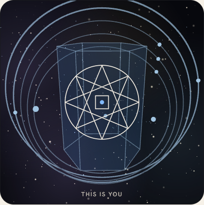
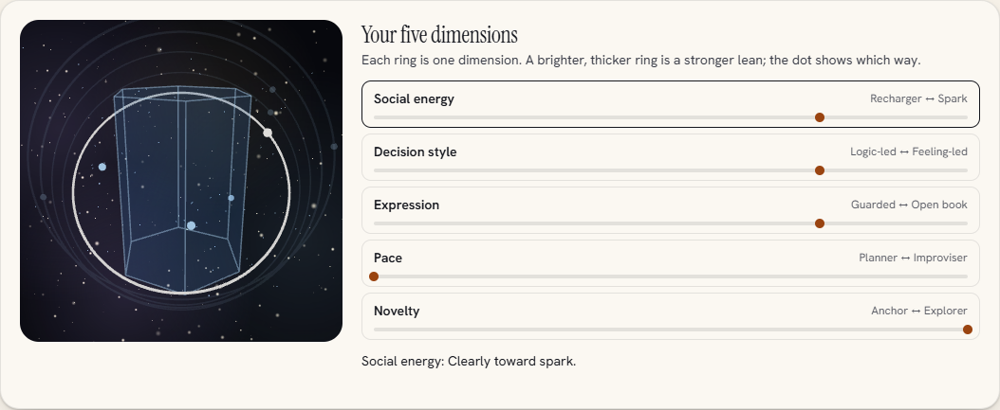
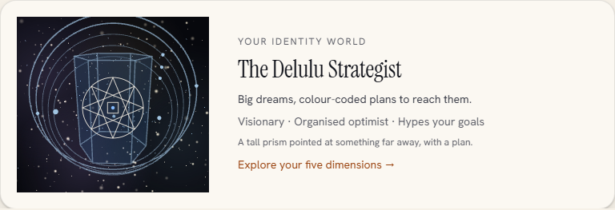

## 5. Social worlds

- **Circle world and Your constellation** share one deterministic star-map layout (`src/web/lib/starmap.ts`, tested).
- **Constellation closeness** uses only intents and labels both people chose. It never ranks by personality.
- **Bridges between you** keeps the compatibility engine's rule that dimensions are never combined into one score.

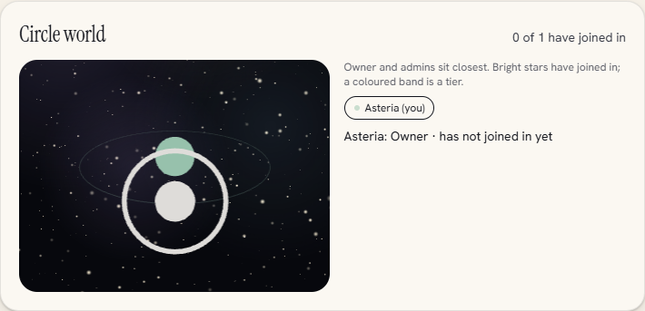
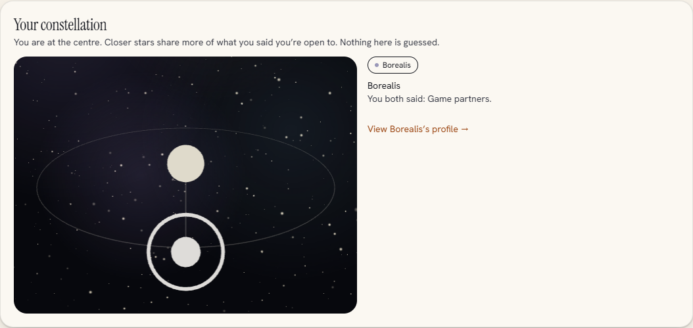
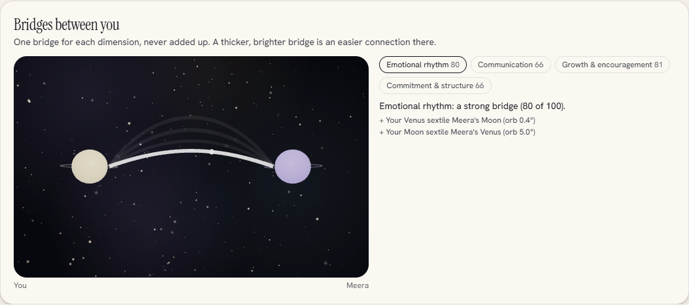

## 6. Play

The game hub's "Rules & play" button opens the same dialog as the game cards. The tournament arena draws only the standings the server already returns, so runs held for review never appear. The season colour comes from the season key, never from the person.

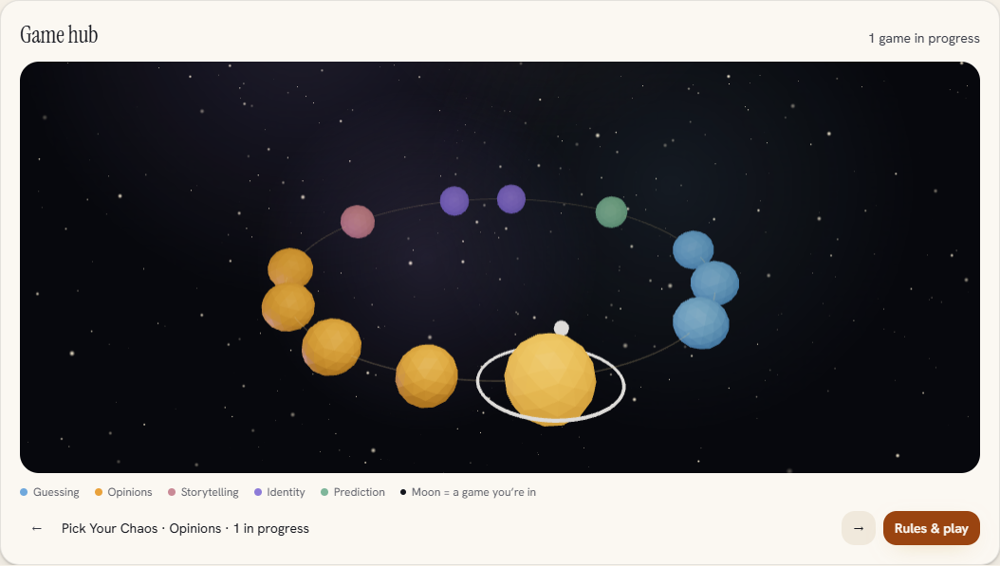
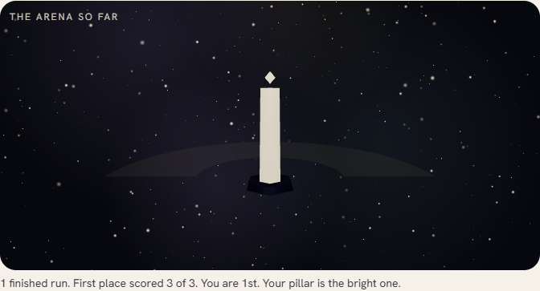
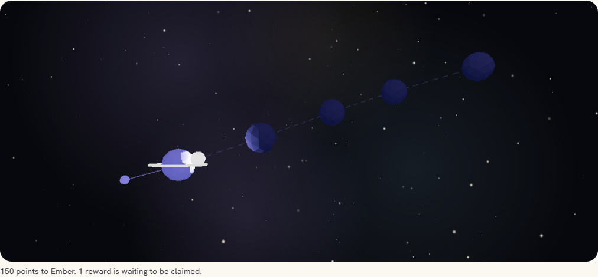
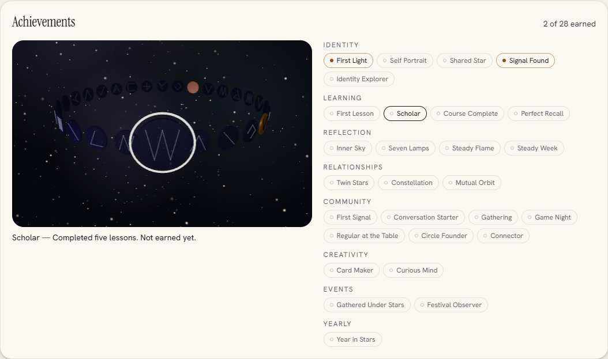

## 7. Expression and creators

- **Year film:** its beats come only from the person's own review (`src/web/lib/yearFilm.ts`, tested). A quiet year gets a short, honest film with nothing invented.
- **Avatar stage:** the medallion's face is the avatar SVG, which is built only from fixed option lists, so no user-supplied markup or geometry is ever rendered.
- **Creator showcase:** shows no prices and has no buy buttons; "See details" scrolls to the offering in the page.

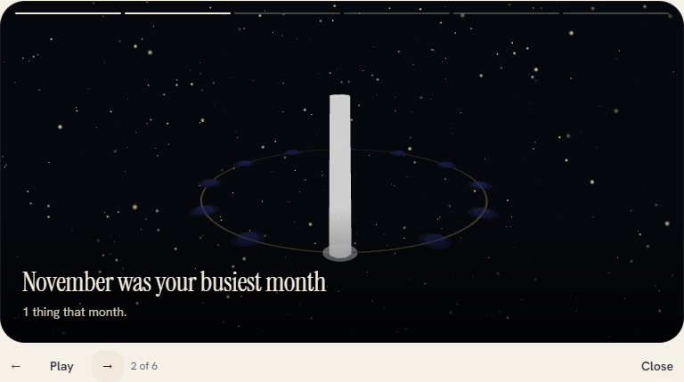
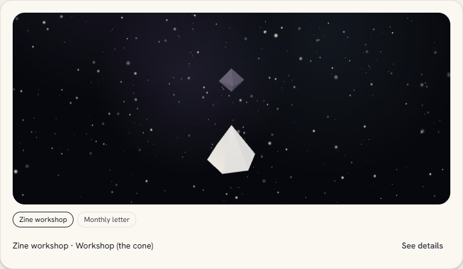
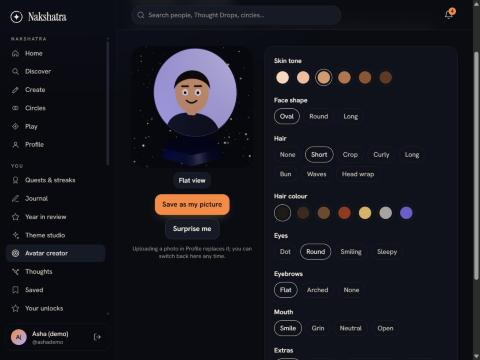

## 8. Motion and sound

Motion presets (`.m-enter`, `.m-reveal`, `.m-fade`, `.m-float`, `.m-pulse`, `.m-glow`, `.m-success`, `.m-error`, `.m-hover`) and the reaction burst run only under no-preference motion and without the in-app reduced-motion setting.

**Interface sounds** (`src/web/lib/sound.ts`, tested):

- Off by default; switched on per device in Theme studio.
- Synthesised in the browser, so there are no audio files to license.
- Each cue is under half a second; there is never music.
- They play only within the browser's user-activation window after a tap, so never on load or on a timer.

## 9. Accessibility and fallbacks

- Every scene has an `aria-label` describing what it shows and a DOM equivalent: lists, status lines and buttons that drive it.
- Without WebGL, every scene shows its 2D drawing. A test blocks WebGL and checks the identity experiences still work.
- Reduced motion and Eco show finished, still scenes. The film never advances by itself under reduced motion.
- All new pages pass the 360px no-sideways-scroll check.

## 10. Privacy and safety

- **Profile world:** data comes from `identity/u/:handle`, which applies visibility, blocks and the per-field archetype setting. A test shows the world disappearing when the owner hides their archetype.
- **Constellation:** opt-in both ways; a blocked person disappears (tested).
- **Circle world:** shows only what members can already see.
- **Avatar stage:** no user-supplied SVG or geometry is rendered.
- **Payments:** remain off. No scene sells anything or targets anyone by inferred traits.

## 11. Performance (measured, not assumed)

**Bundle size (production build):**

- three.js chunk: 704 kB (182 kB gzipped). It loads only when a scene is shown.
- Each scene chunk: 2.6–7.3 kB (identity is the largest).
- Page wrappers: 5–10 kB.

**Frame times:** `E2E_PERF=1 npx playwright test` (`e2e/perf.spec.ts`), Edge with the GPU requested, 1366×900, full motion, 4 seconds per page. Renderer: Intel UHD Graphics (integrated, Direct3D 11 via ANGLE). Raw data: [`3d-report/perf.json`](3d-report/perf.json).

| Page | Scenes | Frames per second | Median frame | p95 | Slowest |
| --- | --- | --- | --- | --- | --- |
| /identity | 2 | 120.3 | 8.3 ms | 8.5 ms | 8.7 ms |
| /home | 1 | 120.5 | 8.3 ms | 8.6 ms | 8.9 ms |
| /progress | 2 | 120.3 | 8.3 ms | 8.6 ms | 8.9 ms |
| /play | 1 | 120.5 | 8.3 ms | 8.5 ms | 8.8 ms |
| /u/:handle | 1 | 120.5 | 8.3 ms | 8.6 ms | 8.9 ms |

Every page held the browser's frame cap with no dropped frames on this integrated GPU. On a phone the numbers would be lower, and they have not been measured here.

## 12. Assets and licensing

- No 3D model, texture or audio files were added.
- All geometry is procedural (three.js primitives).
- All artwork reuses the repository's own SVG set.
- Nothing is hotlinked and nothing was downloaded.

A GLB/KTX2 pipeline was not needed and was not built.

## 13. Tests

All passing at the last full run:

- **Unit tests:** 423 of 423 in 63 files. New layout tests cover the star map, bridges, hub, arena and season, year film and sound.
- **Browser tests:** 51 of 51. New specs `z6`, `z7`, `z8`, `z9` and `z10`; `b-relationship` and `p-tournament` were extended.
- **Typecheck, lint and production build:** clean.

The one `webgl_context_lost` line in the browser log comes from the resilience test that forces a GPU loss on purpose.

Two small changes came after the last full run: the "Your" compatibility wording and the avatar stage camera. After them, the bond and privacy browser tests, the screenshot specs, all 233 astrology and server unit tests, and typecheck and lint were re-run and passed.

## 14. Bugs found and fixed

- **False GPU-loss reports:** every 3D scene sent a GPU-failure report when you left it. Reports now come only while the scene is on the page.
- **Washed-out scenes:** scenes looked washed out on the light theme; stages are now always dark.
- **Theme studio overflow:** the graphics selector overflowed at 360px; it's now a dropdown.
- **Season colours:** three.js could not read space-separated `hsl()`, so reached season worlds rendered white. They now use commas.
- **Hidden bridges:** mirrored compatibility bridges overlapped, so four looked like two. Each now has its own height.
- **Unclear path order:** the season spiral hid its own order; the path now climbs left to right.
- **Avatar texture:** loading the SVG straight into WebGL could leave the face blank, so it's drawn onto a canvas first.
- **"You's" wording:** compatibility factors read "You's Venus". They now read "Your Venus". Compatibility results already stored keep the old wording until they are recalculated.
- **Year film wording:** "1 things" and "in one month".

## 15. Not done, and known limits

- **Phones and slower devices:** no frame-rate or Core Web Vitals measurements on real phones or low-end hardware.
- **Avatar stage in the test browser:** the face does not render in the headless test browser, which uses a software GPU. It does render in the real browser (screenshot above). The test checks behaviour, not pixels.
- **No visual regression baselines:** screenshots are for review, not compared automatically.
- **Not built:** rigged or animated 3D avatars, a WebGPU path, a GLB/KTX2 pipeline, journal/calendar atmospheres, and voice/photo drop effects.

## 16. Release state

- **Git:** every batch is committed locally on `product-evolution`, without force or history rewrites.
- **GitHub:** not pushed. This machine has no remote and no credentials, so a push needs a repository URL and sign-in from the owner.
- **Supabase:** not contacted for writes. The linked project is treated as production; the read-only audit is still pending because the project was hibernated.
- **Local:** the app runs at http://localhost:4500. Ports 3000 and 4000 (ATLAS) were never touched. The local database is preserved, with backups taken before each migration. Payments are off (`PAYMENTS_ENABLED=false`, `PAYMENT_PROVIDER=none`).
